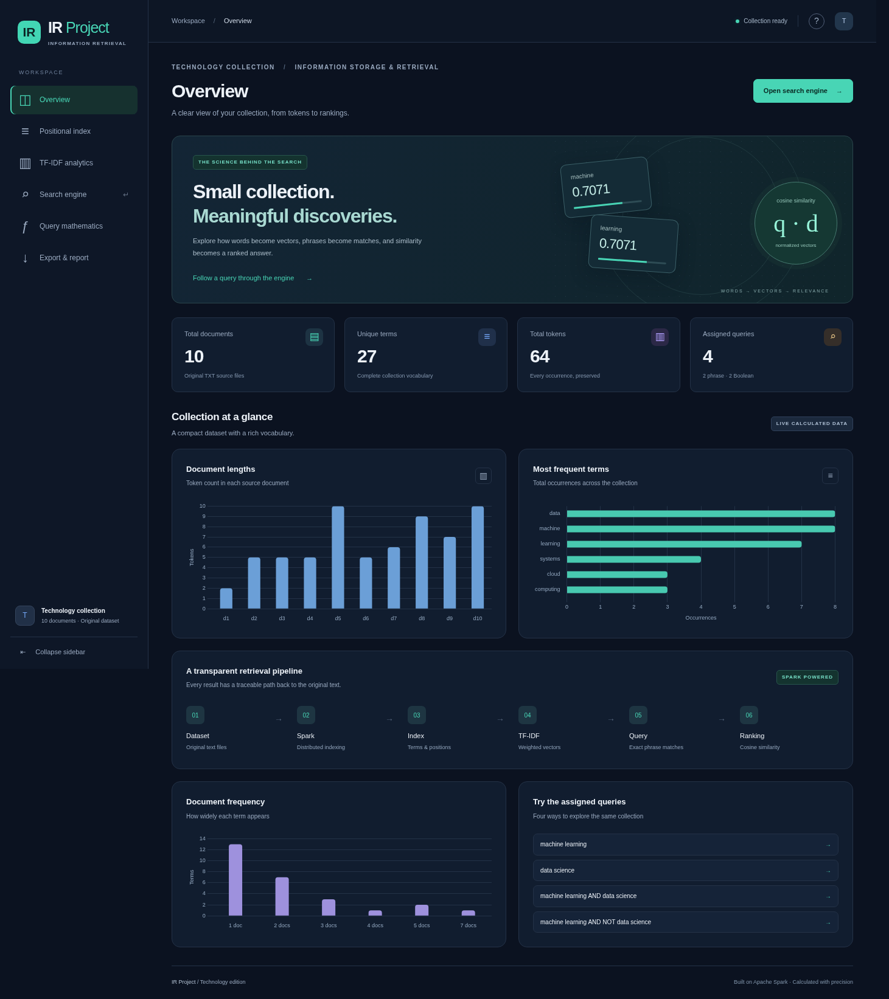

# IR Project · Technology Search Engine

A complete Information Storage and Retrieval project: **real Apache Spark
indexing**, exact positional phrase matching, Boolean retrieval, full-precision
TF-IDF, and an educational Flask interface. HTML, CSS, vanilla JavaScript, and
locally bundled Chart.js; no database, cloud API, or frontend framework.



## What is included

Arabic discussion aids: [Part C file-location map](docs/SUBMISSION_MAP_AR.pdf) and [five theoretical explanations](docs/THEORY_AR.pdf).

- Exact Technology dataset: 10 documents, 27 unique terms, 64 tokens.
- Spark-built positional index and all 27 × 10 required calculation matrices.
- Phrase, AND, AND NOT retrieval; cosine ranking and individual term contributions.
- Six pages: Overview, Positional Index, TF-IDF Analytics, Search, Query Mathematics,
  and Export & Report. Filters, heatmap, original-document highlighting, charts,
  downloads, keyboard forms, responsive layouts, and reduced-motion support.
- All generated JSON/CSV results in `outputs/`; actual screenshots in `screenshots/`.
- [Project report](docs/PROJECT_REPORT.md), [Egyptian Arabic study guide](docs/STUDY_GUIDE_AR.md),
  [requirements map](docs/REQUIREMENTS.md), and [validation evidence](docs/VALIDATION.md).
- Windows double-click fallback and a reproducible Windows executable build script.

## Verified toolchain

Tested here on Linux with **Python 3.12.14, PySpark / Spark 4.0.1, OpenJDK 21.0.13,
Flask 3.1.2, Waitress 3.0.2**, and system Chromium. Spark 4 requires Java 17 or 21.
Python 3.12 is recommended for the scripts below. Chart.js 4.4.9 is included
locally with its MIT license in `static/vendor/`.

**Windows executable status:** a Windows `.exe` cannot be built on this Linux
machine. `build_exe.bat` is provided; the Windows binary, Windows batch execution,
and Docker Desktop on Windows have not been verified here. The Linux Docker image is validated separately as recorded below. PyInstaller packages
only the GUI and already generated results, **not Spark or Java**.

## Windows: run the finished GUI

1. Clone/download this repository, and open its folder using **File → Open Folder**
   in VS Code. In PowerShell, use the repository root as the working directory.
2. With Python 3.12 installed, double-click **`Launch_IR.bat`**. On its first run it
   creates `.venv` and installs only the small GUI requirements. After that the
   GUI works offline. No Docker or Java is needed to use committed outputs.
3. The launcher starts a loopback-only Waitress server and opens your browser
   after a functional readiness check. Leave its console open. Press **Enter in
   that console** to stop the server. Reopening the launcher uses the existing
   instance. If port 5000 is occupied it chooses an available port automatically.

Equivalent development commands in the VS Code PowerShell terminal:

```powershell
py -3.12 -m venv .venv
.\.venv\Scripts\python.exe -m pip install -r requirements-gui.txt
.\.venv\Scripts\python.exe validate.py
.\.venv\Scripts\python.exe launcher.py
```

For a terminal-only development server:

```powershell
.\.venv\Scripts\python.exe app.py
# Open http://127.0.0.1:5000 in your browser. Ctrl+C stops it.
```

No activation or PowerShell execution-policy change is required when calling the
virtual environment's Python directly. The checked-in `outputs/` were generated
by the real Spark job and are validated against the source data fingerprint.

## Windows + Docker Desktop: reproduce Spark preprocessing

Docker is for **preprocessing**, not for everyday GUI use. Use Docker Desktop
with its Linux container / WSL2 backend running. No Hadoop cluster is needed.
The supplied image uses Python 3.12 and Debian's OpenJDK 21 headless runtime.

```powershell
docker version
docker build -t lumen-ir-spark .
docker run --rm -v "${PWD}:/project" lumen-ir-spark
.\.venv\Scripts\python.exe validate.py
.\.venv\Scripts\python.exe launcher.py
```

On a managed network with a private certificate authority, supply your approved
CA bundle during the build instead of disabling TLS verification. For this cloud
machine the verified build command was:

```bash
docker build --secret id=pip_ca,src=/etc/ssl/certs/ca-certificates.crt -t lumen-ir-spark .
docker run --rm lumen-ir-spark sh -c 'python run_spark.py && python validate.py'
```

The optional `pip_ca` build secret is used only for certificate verification
during installation and is not copied into the application or repository.
Ordinary Docker Desktop builds use the default system trust without this option.

The volume mount saves newly calculated files into your local `outputs/` folder.
Spark uses `local[2]`: two workers are ample for this tiny dataset. Keep at least
2 GB available to Docker. Run these commands from the repository root.

A native Python/Spark installation is also available for Linux/macOS, or a
Windows machine with a correctly configured Java runtime. Docker is recommended
for Windows preprocessing to avoid Hadoop/Windows integration issues.

## Linux / cloud development

Java 17 or 21 must already be installed and available on PATH:

```bash
python3.12 -m venv .venv
.venv/bin/python -m pip install -r requirements.txt
.venv/bin/python run_spark.py
.venv/bin/python validate.py
.venv/bin/python launcher.py --no-browser --headless
```

Or run `.venv/bin/python app.py` for a server on port 5000. In this prepared
cloud machine the environment is `/workspace/.venvs/ir`; use its `bin/python`
instead. No secret keys or extra services are needed.

## Build the Windows executable

On **Windows**, double-click `build_exe.bat` or run:

```powershell
.\build_exe.bat
```

It creates a separate `.venv-build`, installs pinned GUI dependencies and
PyInstaller 6.16.0, validates the existing outputs, then builds:

```text
dist/IR_Search_Engine/IR_Search_Engine.exe
```

Distribute the **entire** `dist/IR_Search_Engine` folder, including `_internal`.
Double-click the executable to start the same launcher; Python, Spark, Java,
and Docker are not required on the destination computer. Its console provides
the close control; there is deliberately no HTTP shutdown endpoint. The app
never binds to a public interface by default.

## Search and explore

| Mode | Example | Expected ranking |
|---|---|---|
| Phrase | `machine learning` | d1 > d5 > d10 > d2 > d7 |
| Phrase | `data science` | d5 > d3 > d8 |
| AND | `machine learning` + `data science` | d5 |
| AND NOT | `machine learning` − `data science` | d1 > d10 > d2 > d7 |

Use the separate phrase fields instead of entering a Boolean expression into a
single phrase field. The lowercase word `and` in d5 is a normal indexed term.
Unknown terms return an explicit message and no fabricated matches. Phrase
matching uses consecutive positions, not substring matching. Negative terms are
filter-only and never alter the original document vectors.

The Analytics page has six tabs, term/document filters, precision and density
controls, and table/heatmap views. The Mathematics page traces all ten stages
of a query and lets you compare matching documents. Export & Report downloads
individual generated files or a ZIP of all results. CSV/JSON exports retain full
precision; the GUI defaults to four decimal places.

## Rebuild after editing data

1. Stop the GUI, edit only the intended `data/d<number>.txt` files.
2. Run `python run_spark.py` in an environment with the full requirements and Java,
   or rerun the Docker preprocessing command above.
3. Restart the GUI. If distributing an executable, rebuild it to include new data.

A SHA-256 fingerprint detects edited, added, removed, and renamed dataset files;
the app rejects stale results instead of quietly returning outdated scores.
`validate.py` intentionally checks the **original assigned dataset**, so changing
that dataset causes academic-reference checks to fail. Preserve it for submission.

## Project layout

```text
data/                 Original d1.txt … d10.txt
src/indexing.py       Real Spark index and dataset fingerprint
src/calculations.py   TF, weighted TF, DF/IDF, TF-IDF, L2 normalization
src/queries.py        Positional phrase joins, Boolean sets, cosine ranking
src/exports.py        Full-precision CSV and JSON output generation
src/storage.py        Cache loading and freshness checks
app.py                Flask page / API / export routes
run_spark.py          One-time or manual Spark preprocessing
launcher.py           Waitress desktop launcher and single-instance handling
templates/            Six Jinja pages and shared application shell
static/               CSS, JavaScript, SVG logo, local Chart.js + license
outputs/              All calculated submission outputs, including model.json
tests/reference.py    Independent fixtures transcribed from PDF pages 3–7
validate.py           11 focused mathematical/API/export validation groups
tests/browser_smoke.py Optional Playwright integration and screenshot capture
tests/launcher_smoke.py Readiness, port fallback, duplicate launch, and restart checks
docs/                 Report, Arabic guide, requirement map, validation record
screenshots/          Actual captured application screens
Dockerfile            Reproducible Linux Spark preprocessing environment
Launch_IR.bat         Windows double-click fallback
build_exe.bat         Windows-only executable packaging
```

## Troubleshooting

- **Missing/stale results:** run the Spark preprocessing command again. If an
  executable contains stale assets, rebuild it after preprocessing.
- **Java gateway / JAVA_HOME:** check `java -version`. Use a supported 17/21 JDK;
  `JAVA_HOME` must point to the JDK root, not its `bin` folder. Docker isolates this.
- **Spark hostname binding:** set `$env:SPARK_LOCAL_IP="127.0.0.1"` (PowerShell)
  or `export SPARK_LOCAL_IP=127.0.0.1` (Linux), then rerun the job.
- **Python module missing:** run pip with the same interpreter that launches the
  app. For preprocessing use `requirements.txt`; for GUI-only use `requirements-gui.txt`.
- **Port occupied:** use `launcher.py`; it automatically picks another free port.
- **Browser does not open:** copy the local address printed in the launcher console.
- **Clipboard unavailable:** browser restrictions may prevent copying; values remain
  selectable and downloadable. No external website is required for the app.
- **Validation fails:** preserve the error output; do not round intermediate
  values, edit expected values, or remove assertions to make a failure pass.

For optional browser validation, install `playwright==1.62.0` in a separate test
environment, install its Chromium (`python -m playwright install chromium`), start
the app, and run `python tests/browser_smoke.py`. Set `IR_BROWSER_EXECUTABLE` to
an existing Chromium binary if using a system browser. These are development-only
tools and are not packaged into the GUI. The launcher itself can also be checked with `python tests/launcher_smoke.py` using the GUI virtual environment.
